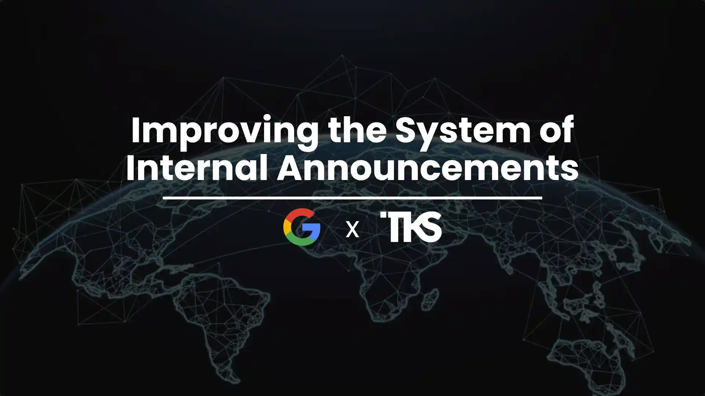

## Gallery

## Links

- [Google Internal Announcements RAG MVP](/projects/google-internal-announcements-rag-mvp)
- [Finalist presentation, August 6, 2024](https://www.loom.com/share/376a027ba4e14d12a448110c923124a2?sid=6cf7e0a9-0546-48dc-aa97-7c9a7c1243e3)
- [MVP demo](https://www.loom.com/share/4354baad3c824832b273c5d18267f0a2)

<!-- Sources: resume.md; linkedin_export/projects.md; content/projects/google-internal-announcements-rag-mvp.md.
Review: August 2024 is the documented finalist presentation month. Recognition is for the TKS Google Canada challenge solution, not employment at Google or an internal production deployment. Gallery image is a presentation slide, not an award certificate. -->
